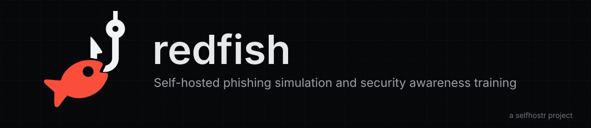

<div align="center">

<a href="https://redfish.selfhostr.io"></a>

<h3>redfish runs authorized security awareness campaigns, self hosted, for your organization.</h3>

[](https://github.com/selfhostr/redfish/actions/workflows/ci.yml) [](https://scorecard.dev/viewer/?uri=github.com/selfhostr/redfish) [](LICENSE)

</div>

Screenshots: [screenshots/](screenshots/)

## Overview

redfish is a self-hosted platform for authorized security awareness campaigns and training. You run a campaign against your own team, from CSV import to launch, tracking and report, and a target who clicks lands on an awareness page. No credential is ever captured, by design: the simulated login page records no input. It is multi-organization, with per-organization sending profiles, retention and reports.

Free, for good. MIT licence, no paid edition.

## Quick start

Needs Docker with Compose.

```sh
git clone https://github.com/selfhostr/redfish.git
cd redfish
cp .env.example .env     # set REDFISH_SECRET_KEY: openssl rand -base64 32
docker compose up -d
```

The app answers on <http://localhost:3000>, and `GET /health` returns `{"status":"ok"}`. Create the first operator account on first visit. The SQLite database lives in `data/`: back that folder up, or enable the Litestream profile. See the [installation docs](https://redfish.selfhostr.io/docs/) for production setup, including host isolation and continuous backup, and [docs/deployment.md](docs/deployment.md) for running behind a reverse proxy.

## Features

- **Campaigns.** Organizations, targets by CSV import, and campaigns with scheduled launch.
- **Sending profiles.** Per-organization SMTP credentials, encrypted at rest.
- **Tracking.** Opens, clicks and reports through unique links, with detection of mail scanners and bots.
- **Awareness, not traps.** A click lands on an awareness page, and no credential is captured by design.
- **Reports.** A funnel report per campaign, viewable in the browser or as PDF.
- **Scenarios.** The platform ships no scenario: you bring your own, created in-app or imported as a JSON bundle (MJML email plus HTML pages, zero-capture enforced).
- **Retention.** Daily anonymization of expired targets, with configurable retention.
- **Isolation.** A strict CSP and host isolation between the operator dashboard and the public tracking links.

## Architecture

SvelteKit 2 (Svelte 5, TypeScript) with Tailwind CSS 4, Drizzle ORM on SQLite (better-sqlite3), and MJML for email. A second process, the worker, runs a database-backed job queue for email sending, scheduled launches and retention. Everything ships as a Docker image. See the [docs](https://redfish.selfhostr.io/docs/).

## Limits

- Authorized use only: written agreement from the target organization is required. Running simulated campaigns against people without their organization's agreement is illegal in most places, and you are responsible for your engagements.
- No credentials are ever captured, by design. A change that stores what a target typed will not be merged.
- A single SQLite database and a single worker: redfish targets one team, not a horizontally scaled service.
- No scenario is shipped: you create or import your own before running a campaign.
- Status: alpha. Releases are 0.x: anything may change between minor versions.

## Contributing

Issues and pull requests are welcome: [CONTRIBUTING.md](CONTRIBUTING.md). Security issues: [SECURITY.md](SECURITY.md).

## License

MIT, see [LICENSE](LICENSE). Provided "as is", without warranty of any kind.

## Support redfish

redfish is free and has no company behind it. If it saves you time, you can support its development:

[Sponsor us on GitHub](https://github.com/sponsors/selfhostr), recurring or one off.
